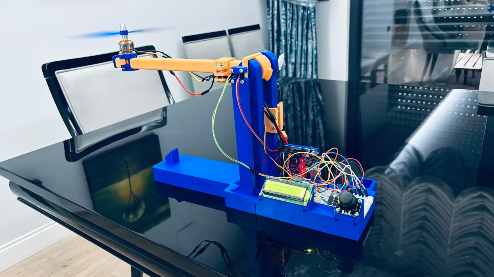
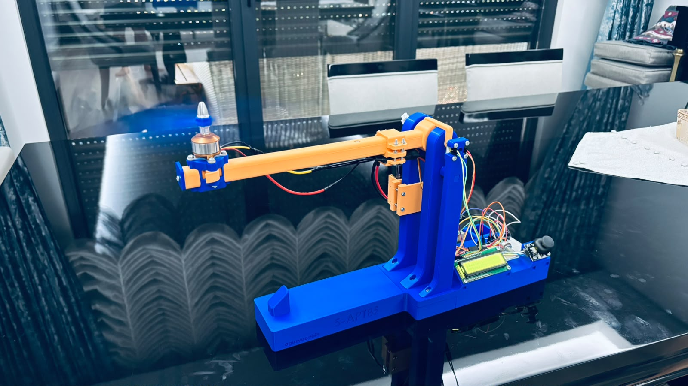
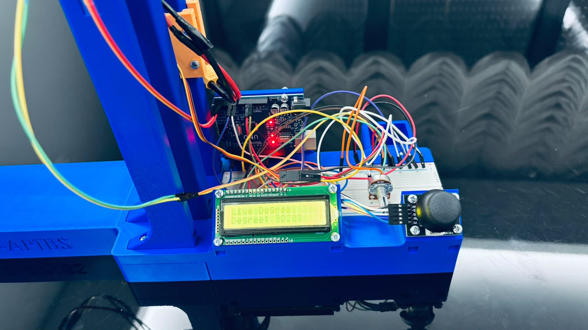
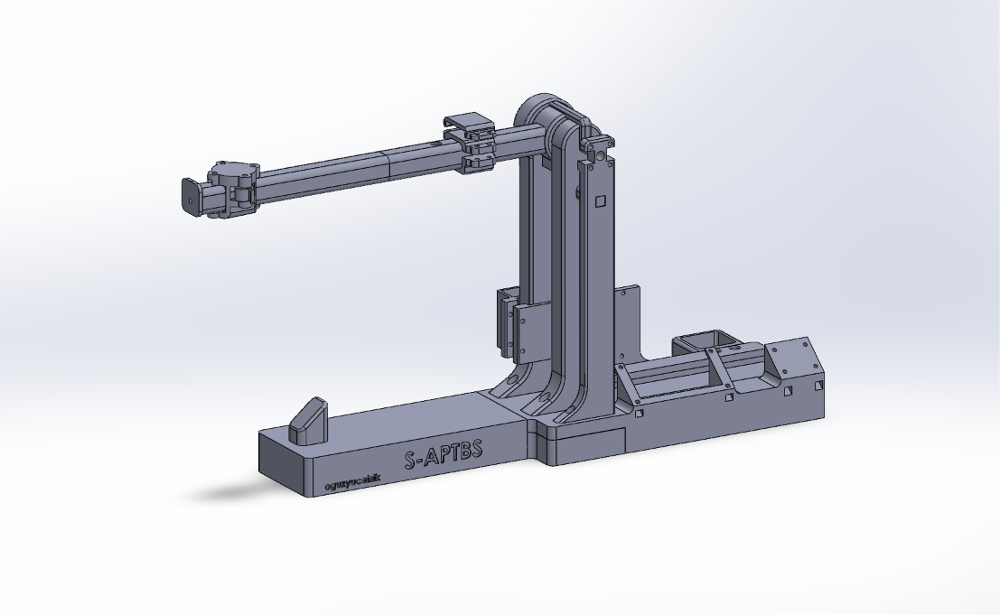
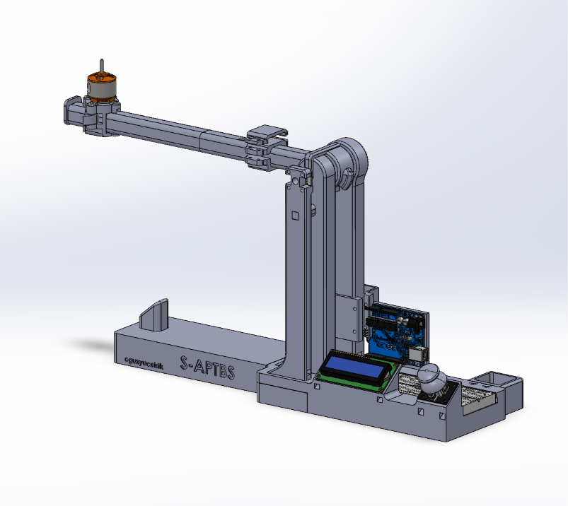
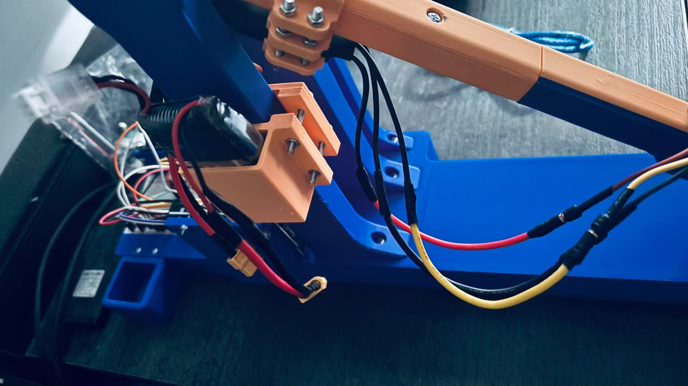
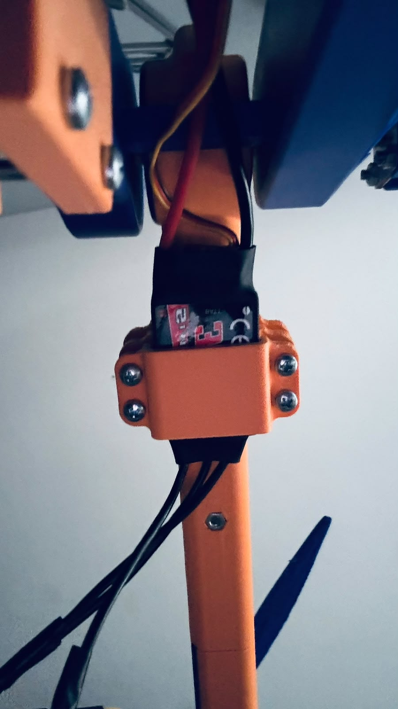
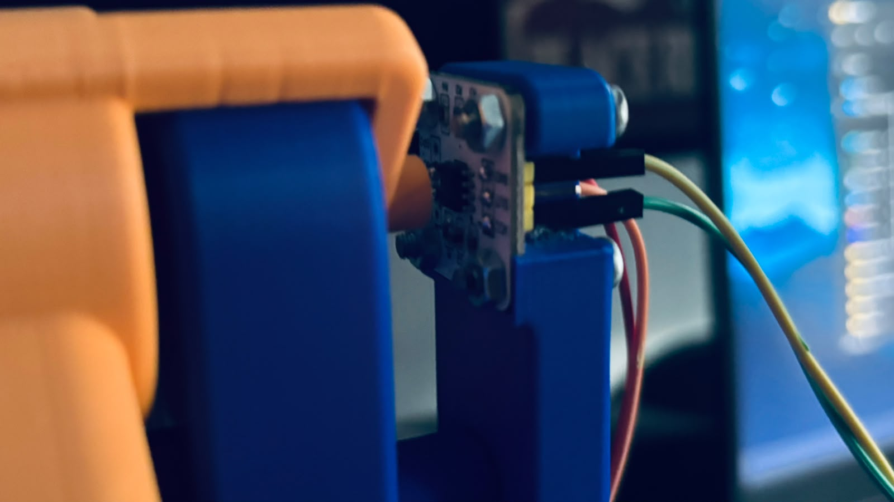

# 1-DOF-Propeller-Thrust-Balance-System

A 1-Degree-of-Freedom (1-DOF) closed-loop thrust balance arm controlled by a Brushless DC motor and an AS5600 12-bit magnetic rotary encoder, powered by an Arduino.

---

## Overview

This project demonstrates closed-loop attitude control of a thrust-balanced lever arm. A custom PID controller runs at a deterministic 50 Hz (`dt = 0.02 s`), stabilizing the arm against gravity at any desired angle. System parameters (`Kp`, `Ki`, `Kd`, and target angle) can be adjusted in real time via a 2-axis analog joystick and an interactive 1602 LCD menu without interrupting the control loop.

---

## Features

- **Deterministic Loop Timing:** Control loop executes strictly at 50 Hz using non-blocking timer logic.
- **Custom Modular PID Implementation:** Written natively in C and wrapped as a C++ source file (`saptbsPID.cpp` / `saptbsPID.h`) for seamless compilation with the Arduino toolchain.
- **Integral Anti-Windup:** Prevents integrator saturation and aggressive overshoot using strict clamping boundaries (±750 µs).
- **Base Actuator Offset:** Actuator output is mapped onto standard ESC pulse widths (1000–2000 µs).
- **Live Telemetry & Interactive Menu:** Real-time angle monitoring and on-the-fly gain tuning via a 1602 LCD and analog joystick.
- **Mechanical CAD Package:** Full assembly in universal STEP format (chassis, pivot bearings, M3 thread, motor lever arm) and a printable propeller STL.

---

## Hardware Architecture

| Component | Specification | Function |
| :--- | :--- | :--- |
| **Microcontroller** | Arduino Uno | Main control loop, sensing, and ESC PPM generation |
| **Feedback Sensor** | AS5600 12-bit Rotary Encoder | Contactless angle measurement via I2C |
| **Actuator** | Brushless Motor + Propeller | Dynamic thrust generation |
| **ESC** | 30A Brushless ESC | Motor driving |
| **Interface** | 1602 Character LCD | Live telemetry display and tuning interface |
| **Input** | 2-Axis Analog Joystick Module | Menu navigation and runtime parameter updates |

---

## Pinout Configuration

| Peripheral | Arduino Pin |
| :--- | :--- |
| **ESC Signal** | D6 |
| **AS5600 SDA** | A4 |
| **AS5600 SCL** | A5 |
| **Joystick X-Axis** | A0 |
| **Joystick Y-Axis** | A1 |
| **Joystick Button** | D2 |
| **LCD RS, EN** | D7, D8 |
| **LCD D4–D7** | D9, D10, D11, D12 |

---

## Repository Structure

| Folder | Contents |
| :--- | :--- |
| `saptbsPID_Firmware/` | Arduino sketch (`saptbsPID_Firmware.ino`) and PID library (`saptbsPID.cpp` / `saptbsPID.h`) |
| `saptbsPID_CAD/` | Mechanical design files (`SAPTBSassembly.STEP`, `propeller1.stl`) |
| `assets/` | Photos and images used in this README |

---

## Mechanical & CAD Files

The complete physical assembly files are provided under the `saptbsPID_CAD/` directory:

- **`SAPTBSassembly.STEP`**: Full assembly in a universal CAD format, editable in SolidWorks and other CAD software.
- **`propeller1.stl`**: Ready-to-print mesh of the propeller (PLA or PETG recommended, 10–15% infill).

Individual STL files for the remaining parts can be exported from the STEP assembly.

---

## CAD Preview

---

## Getting Started

1. Clone or download this repository.
2. 3D print the mechanical components (export STL files from `saptbsPID_CAD/SAPTBSassembly.STEP`) and assemble the pivot arm with the AS5600 diametric magnet axially centered.
3. Install the required Arduino libraries via Library Manager:
   - `Servo`
   - `Wire`
   - `LiquidCrystal`
   - `AS5600`
4. Connect the hardware according to the pinout table above.
5. Power the ESC with a 3S LiPo battery. The built-in 5V BEC supplies logic power to the Arduino and all connected peripherals.
6. Open `saptbsPID_Firmware/saptbsPID_Firmware.ino` in the Arduino IDE (keep the `.cpp` and `.h` files in the same folder) and upload it to your Arduino board.
7. Wait 2 seconds during startup for the ESC arming sequence.
8. Use the joystick to navigate the LCD menu, adjust `Kp`, `Ki`, `Kd` on the fly, and command target angles.

---

<!--
## Results
(To be added: step response plot, Kp/Ki/Kd values used, overshoot and settling time.)
-->

## Media

